# ARCHITECTURE.md — Cetak Biru Arsitektur Sistem, ERD, DFD & Alur Kerja
**Sistem Monitoring & Manajemen SKP Nasional POGI (MedCred Enterprise)**
*Dikelola oleh PT Energi Cipta untuk Perkumpulan Obstetri dan Ginekologi Indonesia (POGI)*

---

## 1. Ikhtisar Arsitektur Sistem (*High-Level Architecture*)

Sistem dibangun menggunakan pendekatan **Clean Architecture (Hexagonal Architecture) Monolith dengan Asynchronous Worker Pipeline** untuk menjamin skalabilitas, kemudahan pengujian unit (*100% testable*), dan pemisahan aturan bisnis murni dari detail framework dan database.

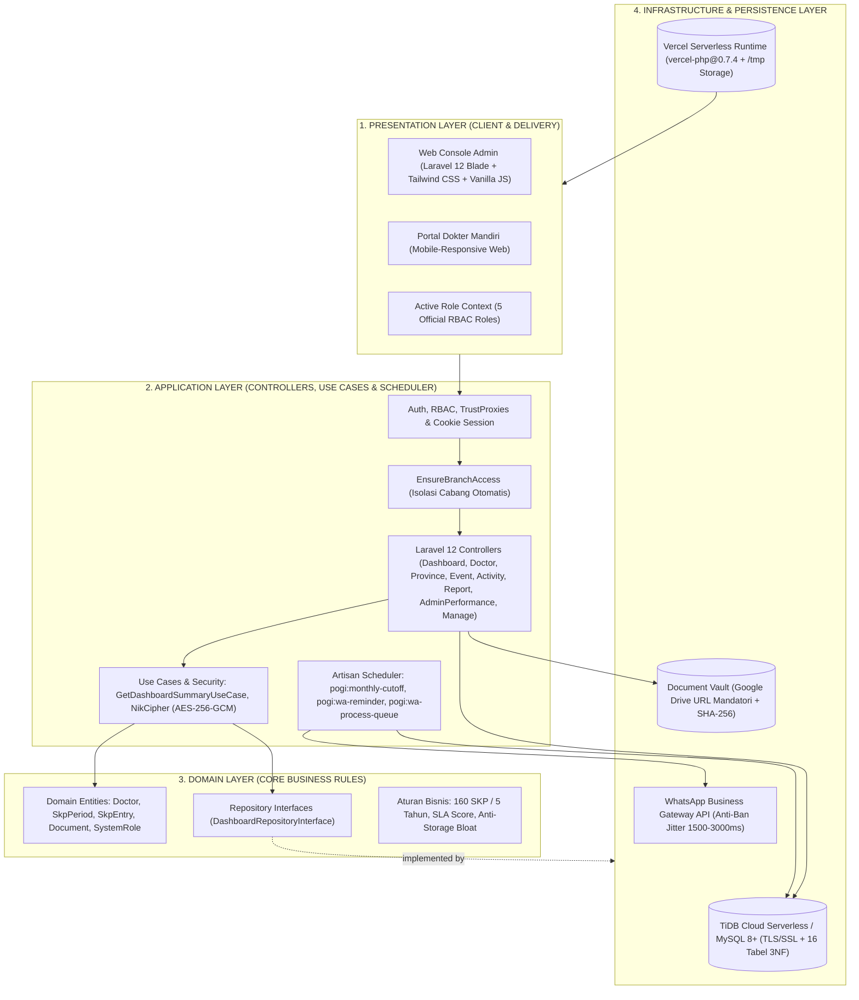

---

## 2. Entity-Relationship Diagram (ERD)

Database dinormalisasi ke tingkat **3NF/BCNF** dengan seluruh tabel menggunakan **RFC 9562 UUIDv7** sebagai *Primary Key* dan terindeks penuh untuk menjamin **Zero Full Table Scan**.

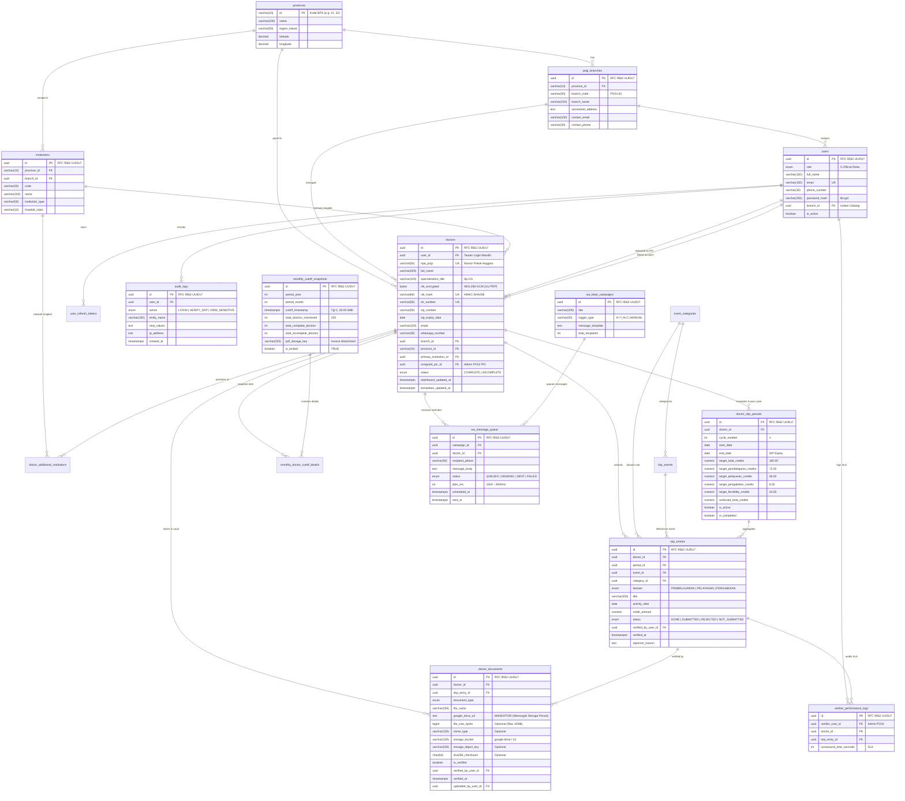

---

## 3. Data Flow Diagram (DFD)

### 3.1 DFD Level 0 (Context Diagram)

Menampilkan batasan sistem dan entitas eksternal yang berinteraksi langsung:

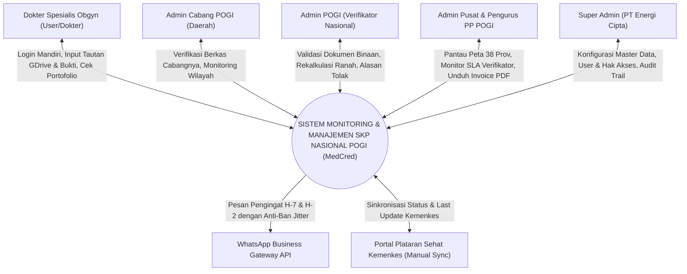

---

### 3.2 DFD Level 1 (Dekomposisi Proses Inti)

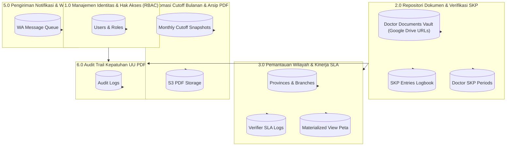

---

## 4. Alur Kerja Operasional (*Workflows*)

### 4.1 Workflow 1: Pengajuan, Verifikasi & Rekalkulasi Otomatis SKP

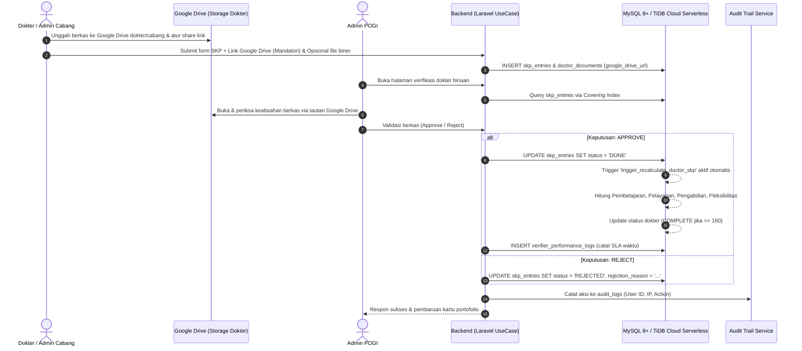

---

### 4.2 Workflow 2: Cutoff Bulanan Tanggal 1 & Pembuatan Laporan Resmi

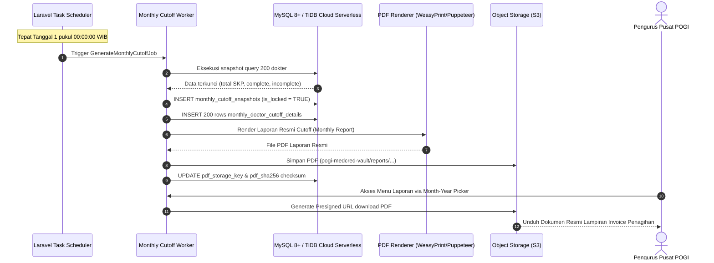

---

### 4.3 Workflow 3: Antrean Notifikasi WA Blast dengan Anti-Ban Jitter

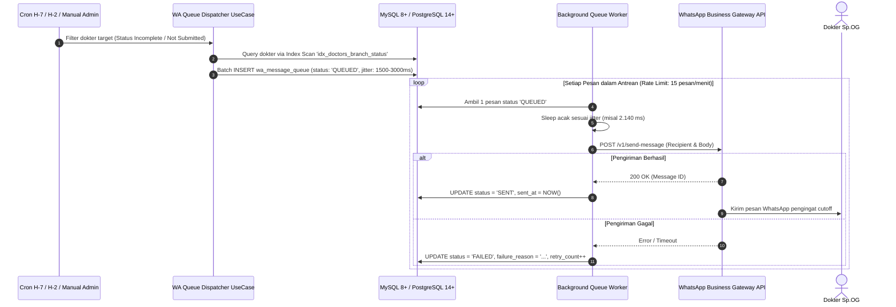

---

### 4.4 Workflow 4: Sesi Akses Portal Kemenkes & Auto-Log Kinerja Admin (Zero-Manual Logging)

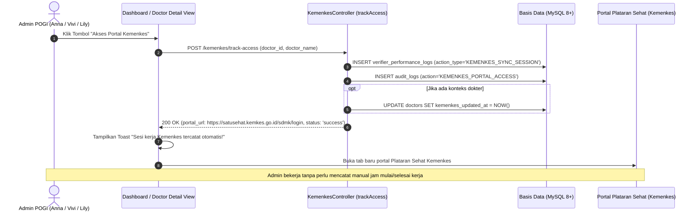

---

### 4.5 Workflow 5: Penetapan & Pengalihan Admin PIC Dokter oleh Super Admin

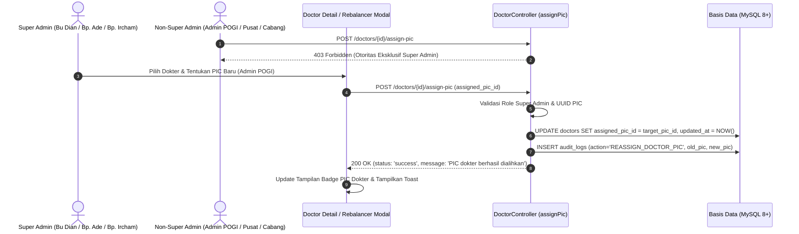

---

## 5. Batasan Sistem & Kendala Teknis (*System Boundaries & Constraints*)

1. **Batasan Integrasi Kemenkes Plataran Sehat & Otomasi Riwayat Sesi**:
   * Portal Kemenkes Plataran Sehat **tidak menyediakan Webhook atau REST API publik**.
   * Sistem beroperasi secara *Assisted-Sync*: berkas diinputkan secara manual ke portal Kemenkes oleh tim Admin POGI (Anna, Vivi, Lily).
   * Untuk meringankan beban administrasi, saat admin mengklik **"Akses Portal Kemenkes"** di dashboard atau top navigation bar, sistem membuka portal resmi **SatuSehat SDMK Kemenkes RI (`https://satusehat.kemkes.go.id/sdmk/login`)** dan secara otomatis merekam log sesi kerja ke `verifier_performance_logs` dan `audit_logs` sehingga SLA dan metrik produktivitas terhitung secara *real-time* tanpa input manual.
2. **Batasan Wewenang Peran (*Role Boundaries*)**:
   * **Super Admin (Bu Dian, Bp. Ade, Bp. Ircham)**: Pemegang wewenang penuh, master data, pengalihan PIC dokter (`assigned_pic_id`), redistribusi beban (*workload rebalancing*), dan penguncian laporan bulanan.
   * **Admin POGI (Anna, Vivi, Lily)**: Pelaksana data entry dan verifikasi berkas SKP. Tidak memiliki akses mengubah PIC dokter.
   * **POGI Pusat (dr. Ulul, Bu Ratna)**: Pemantauan eksekutif nasional (**Hanya bisa cek saja**), dapat meninjau 38 provinsi tanpa batasan, namun tidak dapat mengedit data dokter.
   * **Admin Cabang (Pengurus Daerah)**: Pemantauan cabang daerah (**Hanya bisa cek saja**), terisolasi ketat hanya untuk wilayah cabangnya sendiri melalui *BranchScope*. Tidak dapat mengedit data dokter.
3. **Batasan Rate-Limiting WhatsApp Gateway**:
   * WhatsApp Business Gateway membatasi *throughput* pengiriman maksimal **15 pesan per menit** per nomor resmi.
   * Setiap pesan wajib diproses asinkron menggunakan antrean (*Queue Worker*) dengan delay acak (*jitter*) **1.500 ms – 3.000 ms** untuk mencegah blokir nomor oleh algoritma anti-spam Meta.
4. **Batasan Repositori Berkas (Document Vault) & Kebijakan Anti-Storage Bloat**:
   * **URL / Tautan Google Drive adalah MANDATORI**: Setiap pengajuan bukti fisik SKP (sertifikat simposium, logbook tindakan, surat tugas) **WAJIB** menyertakan URL tautan Google Drive yang dapat diakses (akses share *view*).
   * **Pencegahan Pembengkakan Storage Server (*Storage Bloat Prevention*)**: Kebijakan ini diberlakukan secara tegas karena pengurus dan *stakeholder* khawatir kapasitas *storage* server cepat penuh dan membengkak drastis jika menampung puluhan ribu berkas biner (PDF/gambar) dari ribuan dokter spesialis obgyn di seluruh Indonesia.
   * **Upload Berkas Biner Fisik Langsung Bersifat OPSIONAL**: Sistem tetap menyediakan opsi upload berkas biner langsung ke disk/Object Storage jika sewaktu-waktu dibutuhkan, namun bukan merupakan syarat wajib submit. Jika berkas diunggah, batas maksimal ukuran adalah **10 MB per dokumen** (format PDF, JPG, PNG) dan diamankan dengan *Presigned URL berbatas waktu (maksimal 15 menit)*.
5. **Batasan Isolasi Multi-Tenant Cabang**:
   * Admin Cabang dibatasi secara ketat hanya dapat melihat dokter yang terdaftar di wilayah cabangnya sendiri melalui penerapan **Eloquent Global Scope (`BranchScope`)**. Akses ke dokter cabang lain diblokir otomatis dengan kode HTTP `403 Forbidden`.

---

## 6. Standar Optimasi Database & Query (*Zero Full-Scan Architecture*)

Untuk menjamin latensi respon server tetap **< 50ms** saat data bertumbuh, arsitektur database menerapkan aturan pengindeksan presisi:

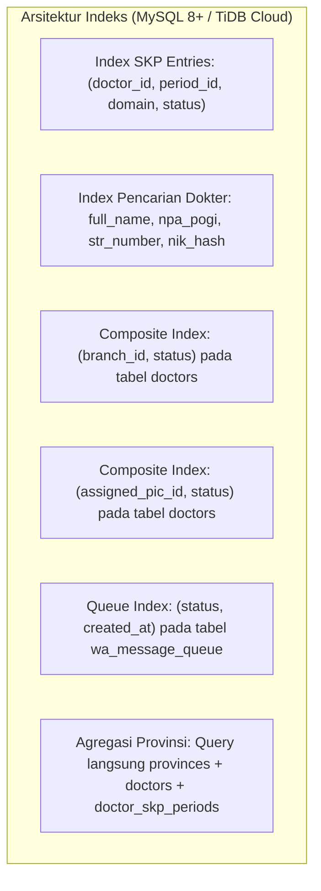

* **Indeks Relasional & Lookup Tanpa Dekripsi**: Pencarian dan agregasi menggunakan indeks relasional B-Tree serta kolom `nik_hash` (HMAC-SHA256) untuk lookup deterministik tanpa mendekripsi seluruh tabel.
* **Agregasi Langsung 38 Provinsi**: Peta kepatuhan dihitung langsung dari data riil tabel `provinces`, `doctors`, dan `doctor_skp_periods` melalui [`ProvinceController.php`](file:///c:/Users/Pongo/Downloads/pogi-spk-tracker/pogi-backend/app/Http/Controllers/ProvinceController.php).

---

## 7. Arsitektur Server-Side Rendering (SSR) & Dual-State Hydration (Zero-Mock Pattern)

Aplikasi mengimplementasikan pola **Production-Grade SSR Dual-Hydration** pada seluruh modul antarmuka:

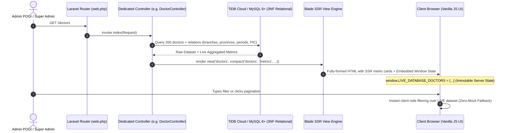

### Keunggulan Arsitektur Dual-Hydration:
1. **Zero Layout Shift & Instant First Contentful Paint (FCP)**: Halaman tiba di browser pengguna sudah dalam keadaan terisi data riil dari database TiDB Cloud / MySQL, meniadakan kedipan (*flickering*) atau skeleton loader berlebih.
2. **Eliminasi Total Mock Fallback**: Variabel state klien tidak lagi merujuk pada `pogi_state.js` atau array tiruan, melainkan dihidrasi dari basis data server melalui `window.LIVE_* = @json($data)`.
3. **Respon Pencarian & Paginasi Sub-Milidetik**: Setelah data server tiba, operasi pencarian teks, pemilihan provinsi, dan penggantian halaman ditangani secara instan pada memori browser tanpa harus bolak-balik menembak round-trip HTTP request berulang kali.

---

## 8. Arsitektur Deployment Produksi (Vercel Serverless + TiDB Cloud)

Aplikasi produksi di-host secara *serverless* di **Vercel** (`console-pogi.vercel.app`) dan terhubung ke klaster **TiDB Cloud Serverless** (`ap-northeast-1`, port `4000`, database `pogi_skp_tracker`):

| Komponen | Implementasi Produksi | Lokasi File |
|:---|:---|:---|
| **Serverless Runtime** | `vercel-php@0.7.4` (PHP 8.3.8) + routing asset statis | [`pogi-backend/vercel.json`](file:///c:/Users/Pongo/Downloads/pogi-spk-tracker/pogi-backend/vercel.json) |
| **Entrypoint & `/tmp` Storage** | Pembuatan direktori `/tmp/storage` & cache bootstrap di `/tmp` (filesystem Vercel *read-only*) | [`pogi-backend/api/index.php`](file:///c:/Users/Pongo/Downloads/pogi-spk-tracker/pogi-backend/api/index.php), [`pogi-backend/bootstrap/app.php`](file:///c:/Users/Pongo/Downloads/pogi-spk-tracker/pogi-backend/bootstrap/app.php) |
| **Proxy HTTPS & Session** | `$middleware->trustProxies(at: '*')` & `SESSION_DRIVER=cookie` | [`pogi-backend/bootstrap/app.php`](file:///c:/Users/Pongo/Downloads/pogi-spk-tracker/pogi-backend/bootstrap/app.php) |
| **Koneksi TLS TiDB Cloud** | Auto-deteksi sertifikat SSL CA (`config/cacert.pem`) untuk koneksi aman `tidbcloud.com` | [`pogi-backend/config/database.php`](file:///c:/Users/Pongo/Downloads/pogi-spk-tracker/pogi-backend/config/database.php) |
| **Enkripsi NIK (UU PDP)** | AES-256-GCM + HMAC-SHA256 deterministik | [`pogi-backend/app/Infrastructure/Security/NikCipher.php`](file:///c:/Users/Pongo/Downloads/pogi-spk-tracker/pogi-backend/app/Infrastructure/Security/NikCipher.php) |
| **Scheduler Otomatis** | `pogi:monthly-cutoff` (tgl 1), `pogi:wa-reminder` (tgl 24 & 28), `pogi:wa-process-queue` | [`pogi-backend/routes/console.php`](file:///c:/Users/Pongo/Downloads/pogi-spk-tracker/pogi-backend/routes/console.php) |
